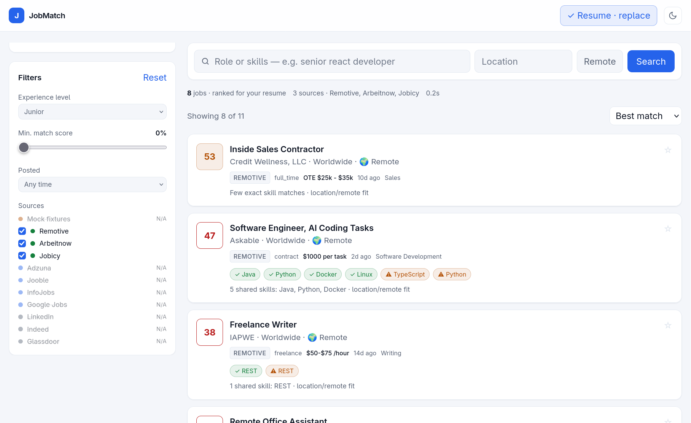
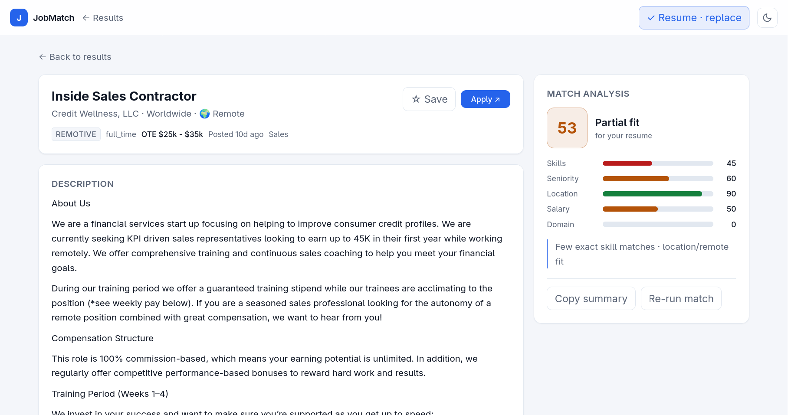
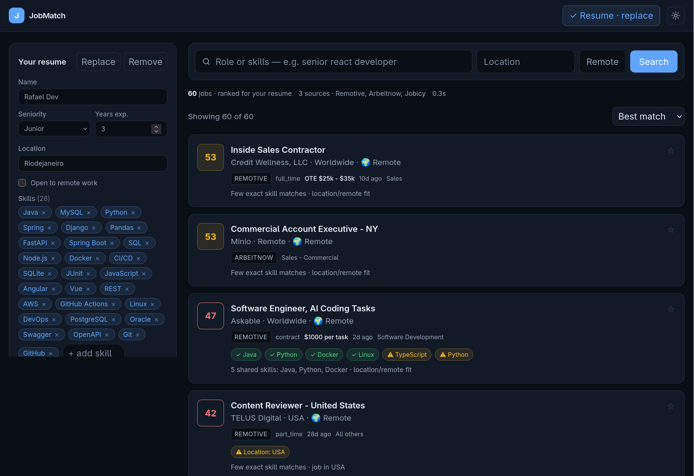
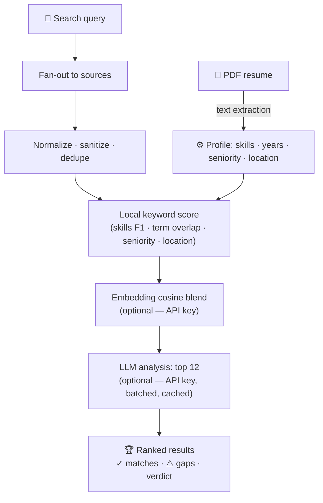

# JobMatch

**Search every job board at once ranked against *your* resume.**
Upload a PDF resume, search once across multiple sources, and get every listing scored
with concrete strengths (`✓ matches`) and gaps (`⚠ gaps`).


> [!TIP]
> Runs with **zero configuration**  keyless sources + local keyword scoring work out of the box.
> Add API keys later to unlock LLM match analysis, semantic ranking and more boards.

## ✨ Features

- 🔍 **Multi-source search** - fan-out across boards with timeouts, normalization and cross-source dedupe; one slow source never breaks the search
- 📄 **Resume parsing** - drop a PDF and instantly get skills, years of experience, seniority, location and languages (parsed locally, fully editable as chips)
- 🎯 **Match scoring** - local keyword scoring always works; add API keys for **semantic (embedding) ranking** and **LLM-written analyses** with a skills / seniority / location / salary / domain breakdown
- 📑 **Job detail view** - full description, Apply link, score breakdown bars, ✓ matches, ⚠ gaps, honest verdict, favorite ⭐, copy-to-clipboard interview summary, re-run analysis
- 🌗 **Dark mode** - toggle in the header, remembered, follows system preference by default
- 📱 **Lite & responsive** - ~90 KB JS + 5 KB CSS gzipped, no UI framework beyond React, mobile-friendly layout
- 🐇 **Fast** - SQLite caching for jobs, vectors and analyses; repeat searches are instant

## 🖼️ Screenshots / Demo










Capture tips: light + dark mode, the resume dropzone, and a job detail page
with a completed match analysis. -->

## 🚀 Quick Start

**Prerequisites:** [Node.js](https://nodejs.org) **≥ 24** (uses the built-in `node:sqlite`), npm.

```bash
git clone <your-repo-url> jobmatch
cd jobmatch
npm install
npm run dev
```

| | URL |
|---|---|
| 🖥️ UI | http://localhost:5173 |
| ⚙️ API | http://127.0.0.1:3001 |

**Production (single server serving the built UI):**

```bash
npm run build
npm start          # → http://127.0.0.1:3001
```

Then open the app, drop your PDF resume into **Your resume**, and hit **Search**.

## 🔑 Configuration

Everything is optional — copy the template and fill in what you want:

```bash
cp .env.example .env
```

### Matching (optional)

Any OpenAI-compatible endpoint works — OpenAI, OpenRouter, Groq, or a local Ollama
(`http://localhost:11434/v1`).

| Key | Unlocks |
|---|---|
| `LLM_API_KEY` or `OPENAI_API_KEY` | LLM match analysis (breakdown, strengths, gaps, verdict) for the top results |
| `EMBEDDING_API_KEY` | Semantic (embedding) ranking blended with keyword scoring |
| `LLM_BASE_URL` / `EMBEDDING_BASE_URL` | Endpoint override (default `https://api.openai.com/v1`) |
| `LLM_MODEL` / `EMBEDDING_MODEL` | Model override (defaults `gpt-4o-mini` / `text-embedding-3-small`) |

Without keys, search, resume upload and scoring still work fully — keyword-based only.

### Job sources (optional)

| Key | Unlocks |
|---|---|
| `ADZUNA_APP_ID` + `ADZUNA_APP_KEY` | Adzuna: indexes many boards (free at [adzuna.dev](https://adzuna.dev)) |
| `JOOBLE_API_KEY` | Jooble aggregator (free at [jooble.org/api](https://jooble.org/api)) |
| `INFOJOBS_KEY` + `INFOJOBS_SECRET` | InfoJobs official API (Spain/Europe, [developer.infojobs.net](https://developer.infojobs.net)) |
| `SERPAPI_KEY` | Google Jobs via [SerpAPI](https://serpapi.com) (free monthly tier) |
| `ENABLE_MOCK=1` | Offline fixture jobs for development without network |

### Misc

| Key | Default | Purpose |
|---|---|---|
| `HOST` / `PORT` | `127.0.0.1` / `3001` | API bind address |
| `SOURCE_TIMEOUT_MS` | `9000` | Per-source fetch timeout |
| `DATA_DIR` | `./data` | SQLite location — delete `data/jobmatch.db` to reset |

## 🎯 How Matching Works



All caches (jobs, vectors, analyses, resume) live in `data/jobmatch.db` — SQLite via
Node's built-in `node:sqlite`, **zero native dependencies**.

> [!NOTE]
> The resume text stays on your machine. It is only sent to an LLM/embedding endpoint
> **if you configure one**.

## 📡 Job Sources

| Source | Kind | Key needed | Notes |
|---|---|---|---|
| Remotive | keyless | — | Remote jobs |
| Arbeitnow | keyless | — | Job board, strong in EU |
| Jobicy | keyless | — | Remote jobs |
| Adzuna | API | ✅ free | Indexes many boards |
| Jooble | API | ✅ free | Aggregator |
| InfoJobs | official API | ✅ free | Spain / Europe |
| Google Jobs | API (SerpAPI) | ✅ free tier | Broad coverage |
| Mock fixtures | dev | `ENABLE_MOCK=1` | Offline test data |
| LinkedIn · Indeed · Glassdoor | scraper stub | — | Disabled by default |

> [!WARNING]
> **Why no LinkedIn/Indeed/Glassdoor scrapers?** They detect automated access
> (login walls, CAPTCHAs, IP bans) and scraping violates their Terms of Service —
> a scraper breaks constantly and risks your IP. Their listings still reach this app
> through aggregator sources (Adzuna, Jooble, Google Jobs). If you have an approved
> data agreement and accept the risk, implement `search()` in
> `server/src/adapters/scrapers.ts` with Playwright — the rest of the pipeline needs
> no changes.

## 🌐 API Reference

| Method | Endpoint | Description |
|---|---|---|
| `GET` | `/api/sources` | All sources with availability + reasons |
| `GET` | `/api/jobs/search` | Fan-out search  `q`, `location`, `remote`, `sources`, `level`, `minScore`, `datePosted`, `sort` |
| `GET` | `/api/jobs/:id` | One job + full match analysis (computed lazily, cached) |
| `POST` | `/api/jobs/:id/favorite` | Toggle ★ saved |
| `POST` | `/api/jobs/:id/analyze` | Invalidate + re-run the match analysis |
| `GET` | `/api/resume` | Current parsed profile |
| `POST` | `/api/resume` | Upload PDF resume (`multipart/form-data`, field `resume`) |
| `PATCH` | `/api/resume` | Edit skills / seniority / location / languages… |
| `DELETE` | `/api/resume` | Remove the resume |

## 🧩 Project Structure

```
jobmatch/
├── shared/                 types + small pure helpers used by both sides
├── server/                 Fastify + TypeScript
│   └── src/
│       ├── adapters/       one file per source · fan-out · timeouts · dedupe
│       ├── resume/         PDF text extraction (unpdf) + profile parsing
│       ├── matching/       local scoring · embeddings · LLM analysis
│       ├── routes/         /api/sources · /api/jobs/* · /api/resume
│       ├── db.ts           SQLite (node:sqlite) — jobs, vectors, analyses, profile
│       └── index.ts        app wiring + static SPA serving
└── client/                 React + Vite + Tailwind v4
    └── src/
        ├── components/     SearchBar · ResumePanel · Filters · JobCard · Header
        └── pages/          Home (search + results) · JobDetail (analysis panel)
```

## ⚠️ Notes & Limitations

- The resume must be a **text PDF**: scanned/image-only PDFs have no text layer to read.
- **Single-user, localhost by default**: no auth; set `HOST` to expose on a LAN.
- LLM/embedding analysis covers the **top 12** results per search (cost control);
  everything else shows fast heuristic scoring.
- Scores without API keys skew conservative, adding keys calibrates them via the LLM.

## 📄 License

Licensed under the **Apache License, Version 2.0** see [LICENSE](LICENSE) for the full text.
